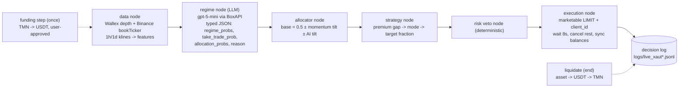

# Wallex Agentic Trading Bot: Submission Document

**Strategy:** multi-market Wallex vs global arbitrage, run as a two-sided inventory bot.
- **Live:** XAUTUSDT only.
- **Shadow (dry-run):** BTCUSDT and ETHUSDT.
- **Structure:** a LangGraph agent with an LLM regime node, a deterministic risk veto and a full decision log.

Sections follow the judging rubric: strategy logic, real AI use, risk management, re-runnability, backtest & shadow, plus the trading-performance evidence.

---
## 1. Strategy logic (why we buy and sell)

**Edge.** Wallex prices tokenised gold (XAUT) and crypto in USDT from a local order book. That book drifts away from the global price (Binance) and then mean-reverts.
- We hold an **inventory** of the asset, about 35–50% of the sleeve.
- When Wallex is **expensive** versus global, we sell part of the inventory to Wallex buyers.
- When Wallex is **cheap**, we buy extra.
- When the gap closes, we return to the base inventory.
- Spot only, long-only. No borrowing, shorting or withdrawals.

**Definitions** (computed every 15 s):
- `global` = Binance bookTicker mid for the same symbol.
- `prem_bid` = Wallex best bid / global − 1 (what we earn if we SELL now).
- `prem_ask` = Wallex best ask / global − 1 (what we pay if we BUY now).
- Wallex depth lists are unsorted, so the bot takes the max bid and the min ask.

| Mode | Enter when | Target asset fraction | Exit (back to `base`) when |
|---|---|---|---|
| base | default | `base` | n/a |
| **sold** (Wallex rich) | `prem_bid > TH` (0.20%) | `base − 0.40` (floor 0) | `prem_ask ≤ 0` (buy back at or below global) |
| **bought** (Wallex cheap) | `prem_ask < −TH` | `base + 0.40` (cap 95%) | `prem_bid ≥ 0` |

**Base inventory (allocator node):**
`base = clip(0.5 + 0.1·sign(20-day momentum) + 0.05·AI_tilt, 0.3, 0.7)`.
- 20-day time-series momentum is the **only** signal that survived our 5-year gold walk-forward (section 5).
- `AI_tilt` comes from the LLM regime probabilities: P(trend_up) − P(trend_down), as a sign.

**Fees.** Wallex USDT pairs cost 0.13% taker. A round trip costs about 0.26% plus the spread, which is why TH = 0.20% applies to the executable price (bid for sells, ask for buys), not to the mid.

## 2. Real AI use (Agentic AI)



- **Framework:** LangGraph `StateGraph` (`bot/multi/live_xaut.py`, method `graph()`), with nodes `data → regime → allocator → strategy → risk → execution`.
- **Model:** `DECISION_BACKEND=openai_compat` calls **gpt-5-mini** on BoxAPI (`bot/multi/decision_model.py: OpenAICompatModel`).
  - It uses a **strict JSON schema** (`SCHEMA`), so the output is typed and normalised: a `Decision` dataclass with `regime ∈ {trend_up, range, trend_down}`, `regime_probs`, `take_trade_prob`, `allocation_bucket` + `allocation_probs`, and `reason`.
  - On any error it falls back to `DeterministicModel` (a softmax over the same features), and the error is logged in `reason`.
- **How the AI changes sizing:** its regime probabilities move the base inventory, which sets every trade size.
  - Example from the live run: AI said trend_down at 0.65 and momentum was −2.71%, so base = **0.37** instead of 0.50. The bot therefore bought only 37% XAUT at start and holds less gold exposure in a down-trend.
- **Call frequency and budget:** one call per 30 min per market. We kept to a $3 total budget, so no LLM calls were made in backtests.

Real live log (2026-10-23 13:41:50 Tehran):
```json
{"event": "ai_regime", "probs": {"trend_up": 0.05, "range": 0.3, "trend_down": 0.65}, "regime": "trend_down", "src": "openai_compat",
 "reason": "Price is below EMA20/50/200 with negative momentum and RSI ~43; ADX ~20 implies only a weak trend but the bias is to the downside...", "mom20d": -0.02707}
```

## 3. Risk and money management (`n_risk`, deterministic veto)

| Rule | Value |
|---|---|
| Spot only, long-only | asset balance never < 0; sells limited to held qty |
| Never all-in | base 30–70%; max asset fraction 95%; the gap swing is ±40% of sleeve |
| Daily drawdown cap | equity −3% vs day start → **halt** |
| Total drawdown cap | equity −5% vs start → **halt** |
| Min order | ≥ 1 USDT and ≥ 5% of equity (no dust/churn; anti-wash) |
| Rate limit | ≥ 10 s between orders; one order per cycle |
| Stale-data guard | skip if the data fetch is > 30 s old |
| Global-reference guard | **new gap entries paused** if the Binance reference hasn't changed for > 300 s, or for XAUT while global gold is closed (Fri 21:00 → Sun 22:00 UTC, plus the daily 21–22 UTC break). Unwinds are still allowed. |
| Sanity guard | \|premium\| > 2% → treat as bad data and skip |
| Order type | LIMIT at the best bid/ask (marketable), unique `client_id`, unfilled rest cancelled after 8 s |
| No withdrawals | the code has no withdraw call at all |

Each veto is logged with its reason (`event: veto`).

## 4. Funding step and end-of-challenge liquidation

- **Funding (once, user-approved)** on 2026-10-22 at 18:32 Tehran: converted TMN to USDT on USDTTMN so the bot can trade USDT pairs.
  - Bought 18.07 USDT for 4,917,064 TMN at 272,112, leaving 82,936 TMN.
  - Logged reason: *"user-approved funding step to USDT base before strategy trading; part of the plan"* (`logs/live_funding.jsonl`).
- **Liquidation** (`liquidate()`, at `LIQ_AT` Tehran or `--liquidate-now`): sells the asset to USDT, then USDT to TMN (`bot/multi/liquidate.py`), verifies balances and writes a `DONE` flag.
  - Returns are realised in TMN as the rules require.
  - The current live run uses `LIQ_AT=99:00` (disabled) because the deadline moved to Monday. Liquidation will be triggered at the end.

## 5. Backtest and shadow testing (including negative results)

**5.1 Overnight order-book replay** (`research/replay_gap.py SYMBOL`): ~5,000 recorder samples over 19.9 h (Oct 22 17:52 → Oct 23 13:43 Tehran) of the real Wallex bid/ask versus Binance.
- Fills happen at the bid/ask after the latency, with a 0.13% fee per side.
- Net per round trip is measured against holding the base inventory.

| Symbol | premium median / std | spread | TH 0.2% (0/5/10 s) | TH 0.3% | TH 0.4% |
|---|---|---|---|---|---|
| **XAUTUSDT** | +0.076% / 0.104% | 4.3 bp | 4 trips, **+0.092 / +0.081 / +0.084 %** per trip | 1 trip, +0.105 / 0 / 0 | 0 |
| BTCUSDT | −0.007% / 0.057% | 7.0 bp | 0 trips | 0 | 0 |
| ETHUSDT | −0.043% / 0.063% | 18.8 bp | 4 trips, −0.046 / −0.054 / −0.055 % | 1 trip, +0.408 | 1 trip, +0.408 |

- **Decision:** only XAUT shows positive net with more than one trip, so **only XAUT trades live**.
- BTC never deviates enough. ETH is negative at 0.2%, and its single positive trip at 0.3% is not evidence. BTC and ETH therefore run in **shadow** (dry-run, same code) to collect more data.
- A bias-adjusted variant (premium relative to its 2 h median) was **worse** (XAUT 0.2%: −0.101% per trip).
- **Honest caveat:** four trips is a small sample.

**5.2 Gold multi-year walk-forward** (`research/gold_wf.py`): Dukascopy XAUUSD 15m, 2021–2026, 12 strategies, Wallex costs.
- **Only daily TSMOM n=20 survives.**
  - Long-only: 61 trades, +2.14% per trade, PF 6.16, +131%, max DD 22%.
  - Inventory mode: +0.86% per trade, PF 3.85, max DD 12%, every year positive.
- **Every intraday strategy (breakouts, RSI/BB mean reversion, ICT-style, EMA crosses) was negative** after the ~0.46% round-trip cost. That is why momentum only sets the base and the gap does the trading.

**5.3 Transfer study** (`research/gold_transfer.py`): Wallex XAUT vs global correlation is 0.31 (15m), 0.62 (1h), 0.81 (4h), 0.97 (1d). Basis median −0.02%, std 0.28%.

**5.4 Popular GitHub strategies** (`research/github_strats.py`): 10 freqtrade-style strategies (BinHV45, ClucMay, CombinedBinHAndCluc, SMAOffset, Supertrend, ElliotV5, …), multi-year walk-forward at 5/10/15 bp cost.
- **None were robust.** CombinedBinHAndCluc made +20% on BTC but −7.8% in 2026 and lost on ETH.

**5.5 Shadow runs**:
- `shadow-usdt` (deterministic multi-strategy paper engine, running since Oct 22): no edge beyond fees in the window.
- `live-xaut` dry-run: tested the full flow, including a simulated buy, the gap cycles and the liquidation path.
- BTC/ETH gap shadows: running now (`logs/live_xaut_{BTCUSDT,ETHUSDT}.jsonl`).

## 6. Decision log format (deliverable)

`logs/live_xaut.jsonl` has one JSON line per event, timestamped in Tehran time. Event types:
- `start` (params, backend, balances)
- `ai_regime` (probabilities and reason)
- `order` (exact payload, `client_id`, reason, mode transition, target fraction, premiums, global price, AI regime, allocation reason, equity, fill, balances after)
- `veto` (rule and proposal)
- `cycle_error`
- `liquidation_*`

Real first live order:
```json
{"time_tehran": "2026-10-23 13:41:59", "event": "order", "dry_run": false,
 "payload": {"symbol": "XAUTUSDT", "side": "BUY", "type": "LIMIT", "price": "4026.9", "quantity": "0.00165", "client_id": "XG_GAP_1792750310_10FFA2"},
 "reason": "initial inventory: buy XAUT to base 37%", "mode_to": "base", "target_frac": 0.37, "premium_bid": -0.0, "premium_ask": 3e-05,
 "global_xaut": 4026.765, "regime": {"regime": "trend_down", "probs": {"trend_up": 0.05, "range": 0.3, "trend_down": 0.65}, "src": "openai_compat"},
 "alloc": {"base": 0.37, "why": "mom20d -2.71% -> -0.1, AI trend_down (openai_compat)"}, "equity_before": 18.01579,
 "fill": {"qty": 0.00165, "avg": 4026.9, "status": "FILLED"}, "balances_after": {"usdt": 11.371405, "xaut": 0.00164785}}
```
Gap trades carry reasons such as `"Wallex bid premium +0.230% > 0.20%: SELL XAUT (rich vs global)"` and `"premium closed (ask -0.010% <= 0): BUY back to base"`.

**Performance report for the demo:** `python tools/report_live.py > report.md`. It is read-only and shows trades, volume, average trade size, fees, PnL in USDT and TMN versus 5,000,000 TMN, and max drawdown.

## 7. Re-running (judges)

```bash
git clone <repo> && cd wallex-agent-bot
python3 -m venv .venv && .venv/bin/pip install -r requirements.txt pandas numpy pytest
cp .env.example .env      # fill WALLEX_API_KEY (and BOXAPI_API_KEY for the LLM); never commit .env
.venv/bin/pytest -q tests
.venv/bin/python research/replay_gap.py XAUTUSDT          # replay table (needs recorder data: python recorder.py)
.venv/bin/python main.py live-xaut --iterations 4         # DRY-RUN (default, no orders, virtual balances)
GAP_SYMBOL=BTCUSDT ./run_gap_shadow.sh BTCUSDT           # shadow for BTC/ETH (always dry-run)
.venv/bin/python main.py live-xaut --liquidate-now        # dry-run liquidation plan
LIVE=1 DECISION_BACKEND=openai_compat LIQ_AT=99:00 setsid nohup ./run_live_xaut.sh --execute &   # REAL orders (XAUT only)
LIVE=1 .venv/bin/python main.py live-xaut --execute --liquidate-now   # final: asset -> USDT -> TMN
.venv/bin/python tools/report_live.py
```

| Env var | Meaning |
|---|---|
| `WALLEX_API_KEY` | Wallex API key (required for balances and orders) |
| `LIVE=1` + `--execute` | both are needed for real orders; otherwise the run is a dry-run |
| `DECISION_BACKEND` | `openai_compat` (LLM), `deterministic`, or `typesafe_jev` |
| `BOXAPI_API_KEY`, `BOXAPI_BASE_URL`, `LLM_MODEL` | LLM endpoint (gpt-5-mini) |
| `GAP_TH` | entry threshold (default 0.002) |
| `GAP_SYMBOL` | market (default XAUTUSDT; any other symbol is forced to dry-run) |
| `LIQ_AT` | Tehran HH:MM for automatic liquidation (`99:00` = off) |

## 8. Limitations and future work
- The replay evidence is thin (four XAUT round trips in 20 h). Expected excess is roughly +0.1–0.2% of the sleeve per active day. Most of the result comes from the inventory's gold exposure, which momentum and the AI reduce in down-trends.
- On weekends global gold is closed and Binance XAUT becomes a weak reference. The guard pauses new entries, so the bot may be idle.
- The sleeve is small (~18 USDT): minimum-notional and step-size rounding matter.
- Future work:
  - maker (post-only) quoting around the global price to save 0.03%/side;
  - multiple reference venues (PAXG, OKX) for a robust global price;
  - a larger multi-day replay set to re-tune TH;
  - promoting ETH to live once the shadow shows enough positive trips.
